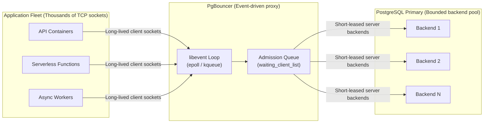

Most teams hit PostgreSQL connection limits the same way. I ran into this firsthand a few years ago on [StartupList Africa](https://www.startuplist.africa/). When a PHP-FPM API, queue workers, high-priority workers, and a scheduler share one managed PostgreSQL instance, open connections climb far faster than active query concurrency.

The tempting shortcut is to raise `max_connections` from `100` to `2000` or `5000` and restart Postgres. That rarely buys real headroom. More often, it turns a clean connection rejection into elevated latency, memory exhaustion, and CPU thrashing across every query on the box.

Putting **PgBouncer** in front of PostgreSQL changed how our stack handled connection fan-in. Understanding *why* it works makes it much easier to size pools, debug queue pressure, and avoid transaction-pooling traps in production.

## The hidden cost of a PostgreSQL backend process

PostgreSQL uses a multi-process architecture rather than an internal thread pool. Every accepted client connection causes the `postmaster` supervisor to fork a dedicated operating system process. That isolation keeps a stray crash or memory issue contained, yet it makes raw connections expensive.

Each live backend allocates private memory for connection buffers, TLS session state, catalog metadata caches, and prepared query plans. Even an idle session commonly settles into several megabytes of RSS once it touches a handful of tables. Multiply that across thousands of mostly idle web workers, and gigabytes of RAM disappear before queries even start.

Memory is only the visible part. When large numbers of backends become active simultaneously, four compounding pressures slow the entire server down:

- **Scheduler thrashing and cache eviction:** When runnable backends greatly outnumber CPU cores, the OS wastes cycles context-switching and flushing L1/L2 caches instead of running queries.
- **Shared-memory lock contention:** Backends coordinate around internal lightweight locks (`LWLock`), buffer mapping partitions, and the `PGPROC` array used to build MVCC snapshots. Even after PostgreSQL 14+ improved snapshot scalability dramatically, hundreds of simultaneous active queries still contend heavily for locks and memory bandwidth.
- **Unpredictable `work_mem` bursts:** PostgreSQL allocates `work_mem` per sort or hash operator *within* a query, not as a global server cap. A moderate `work_mem` multiplied across hundreds of concurrent queries can trigger the OS OOM killer abruptly.
- **Storage and WAL contention:** Hundreds of parallel writers and index scans compete for the same storage IOPS. That contention inflates p95 and p99 latency far more than fewer queries running cleanly in sequence.

Most backend workloads do not need thousands of queries running in the same microsecond. Application pods spend most of their lifecycle waiting on HTTP sockets, upstream APIs, or JSON serialization. They need PostgreSQL for only a few milliseconds per transaction.

## Separating client sockets from database backends

PgBouncer solves this mismatch by sitting in front of PostgreSQL as a lightweight wire-protocol proxy:



Instead of treating an application's network socket and a PostgreSQL execution process as the same resource, PgBouncer decouples them into two tiers:

| Layer | Connection path | Footprint | Typical concurrency |
|---|---|---|---|
| **Client sockets** | Application → PgBouncer | ~2 KB bookkeeping RAM per socket | Thousands (e.g., 5,000–10,000+) |
| **Server backends** | PgBouncer → PostgreSQL | Full OS process + private Postgres caches | Dozens (often 30–120) |

In **transaction pooling** mode, application processes keep long-lived TCP connections open to PgBouncer. PgBouncer lends a PostgreSQL backend strictly while a transaction is in flight:

1. A client starts a transaction (or issues a standalone autocommit statement).
2. PgBouncer checks out an idle PostgreSQL backend from the matching pool.
3. PostgreSQL runs the statements and streams rows back over the wire.
4. On `COMMIT` or `ROLLBACK`, PgBouncer immediately detaches the backend and returns it to the idle set.
5. The next ready client inherits that warm PostgreSQL process without any TCP handshake or `fork()` overhead.

## Inside PgBouncer's event loop

A natural question is why PgBouncer can hold thousands of open connections when PostgreSQL cannot.

The reason is architectural: PgBouncer is a compact C daemon built on **libevent**, running a single-threaded event loop over non-blocking sockets. On Linux it delegates socket readiness monitoring to `epoll` (and `kqueue` on BSD/macOS).

The lifecycle of a client socket inside PgBouncer stays deliberately minimal:

1. PgBouncer accepts the TCP connection and marks the socket non-blocking.
2. It registers the file descriptor with `epoll` / `kqueue`.
3. While the application sits idle between requests, the kernel keeps that socket quiet and PgBouncer spends zero CPU polling it.
4. When a query packet arrives, the kernel notifies the event loop with only the active descriptors.
5. PgBouncer relays the PostgreSQL wire-protocol messages to an assigned backend and moves immediately to the next ready event.

> **How light is this in practice?** In our StartupList Africa Docker setup, one PgBouncer container runs within a cap of **0.3 CPU and 256 MB of RAM**. It accepts up to 1,000 client connections from the web tier, queue workers, and scheduler while holding 25 server connections to PostgreSQL. Because PgBouncer runs on a single thread, one process handles wide idle fan-in at very low overhead. If heavy TLS handshakes or extreme QPS ever saturate one core, scale horizontally with `so_reuseport = 1` on Linux or multiple replicas behind a load balancer.

## Pool isolation, admission queues, and Little's Law

PgBouncer partitions its server pools by `(database, user)` tuple inside process memory:

```text
(billing, api_rw)       → Primary OLTP pool (bounded by default_pool_size)
(billing, reporting_ro) → Separate reporting pool with its own queue
```

Assigning distinct PostgreSQL roles to different workloads is an underrated operational safeguard. If a heavy export job saturates `(billing, reporting_ro)`, the checkout API talking through `(billing, api_rw)` keeps its own server slots untouched.

When active transaction demand briefly exceeds `default_pool_size`, PgBouncer does not immediately fail requests. Excess clients remain connected over TCP and enter an internal C linked list (`waiting_client_list`) inside that pool's memory. There are no external hops or extra brokers. As soon as a backend finishes a transaction, PgBouncer hands it to the client at the head of the queue.

You can step through that exact lifecycle below to compare normal headroom, traffic spikes, pool starvation, and direct unpooled PostgreSQL connections.

::pgbouncer-pool-simulator
::

### Queueing delay vs. collapse (Little's Law in practice)

Admission queueing intentionally introduces wait time during bursts, and **Little's Law** explains why that trade-off works—and where its limits are:

```text
Max Throughput ≈ Pool Size / Average Transaction Duration
```

Consider a 32-slot pool in front of a 16-vCPU primary:

- If your median OLTP transaction takes **8 ms**, those 32 backends sustain roughly **4,000 transactions per second** with almost no queueing.
- If a bad deploy introduces a table lock or unindexed scan that stretches transaction time to **250 ms**, that same pool drops to **128 TPS**. Clients pile up in `waiting_client_list` almost immediately.

Queueing protects PostgreSQL from collapsing under uncontrolled fan-in, giving short spikes a clean landing pad. What a pooler *cannot* do is manufacture database throughput out of thin air. If sustained arrival rate exceeds what your backends can drain, widening the pool usually makes contention worse. Fix the bottleneck instead: tune the slow query, add the missing index, offload reads, or scale the database tier.

## Pooling modes and transaction-pooling pitfalls

PgBouncer offers three pooling modes: `session`, `transaction`, and `statement`. Most web and microservice architectures standardize on `transaction` mode. In `session` mode, a PostgreSQL backend stays locked to one client until the TCP socket closes, offering little fan-in for persistent app pools.

Transaction pooling introduces strict rules around session state. Consecutive transactions on the same client socket may run on different PostgreSQL backends.

::pooling-modes-matrix
::

Four sharp edges account for almost every surprise teams hit after enabling `pool_mode = transaction`:

1. **Prepared statements:** Older PgBouncer releases broke prepared statements in transaction mode, forcing ORMs and drivers (Prisma, SQLAlchemy, `pgx`, Rails) to disable them. **PgBouncer 1.21+** fixes *protocol-level* prepared statements when you set `max_prepared_statements` above `0`. PgBouncer tracks client statement names internally and prepares them lazily on whichever backend runs the transaction. Explicit SQL `PREPARE` / `DEALLOCATE` statements remain incompatible.
2. **Session parameters (`SET`):** Executing `SET statement_timeout = '5s'` or `SET search_path` outside `LOCAL` scope leaks that setting onto the shared PostgreSQL backend for the next tenant or service that reuses it. Use `SET LOCAL` inside an explicit transaction so PostgreSQL reverts the parameter automatically when the transaction ends.
3. **Temporary tables:** A `CREATE TEMP TABLE` belongs to the backend session that created it. In transaction mode, always declare `ON COMMIT DROP`—or route batch jobs that depend on multi-transaction temp tables to a session pool.
4. **`LISTEN` / `NOTIFY` and session locks:** `LISTEN` needs an unbroken link to one backend process to deliver notifications, and `pg_advisory_lock()` outlives transaction boundaries. Switch application locks to transaction-scoped `pg_advisory_xact_lock()`, and keep `LISTEN` subscribers on a dedicated session-mode pool or direct connection.

In practice, exposing **two connection strings** keeps things clean. Route API and worker traffic through a high-fan-in `transaction` pool, and reserve a small `session` pool (or direct primary route) for migrations, `LISTEN` consumers, and debugging.

## What this looks like in production (`docker-compose` and `pgbouncer.ini`)

In our StartupList Africa infrastructure, PgBouncer runs as a small sidecar-style container right inside Docker Compose. The PHP-FPM API, default queue workers, high-priority queue workers, and scheduler all point `DB_HOST` at `pgbouncer`. Long-running ingestion jobs with multi-minute timeouts bypass that pool so they cannot hold slots away from user-facing traffic:

```yaml
services:
  pgbouncer:
    image: edoburu/pgbouncer:latest
    environment:
      - DATABASE_URL=postgres://${DB_USERNAME}:${DB_PASSWORD}@${DB_HOST}:${DB_PORT}/${DB_DATABASE}
      - AUTH_TYPE=scram-sha-256
      - POOL_MODE=transaction
      - MAX_CLIENT_CONN=1000
      - DEFAULT_POOL_SIZE=25
      - MIN_POOL_SIZE=5
      - RESERVE_POOL_SIZE=5
      - MAX_DB_CONNECTIONS=100
      - SERVER_LIFETIME=3600
      - SERVER_IDLE_TIMEOUT=600
      - SERVER_CONNECT_TIMEOUT=10
      - QUERY_TIMEOUT=300
      - CLIENT_IDLE_TIMEOUT=600
    restart: always
    deploy:
      resources:
        limits:
          cpus: "0.3"
          memory: 256M
        reservations:
          cpus: "0.1"
          memory: 128M
```

You may also manage `pgbouncer.ini` directly on a VM or Kubernetes pod. On PgBouncer 1.21+, where protocol-level prepared statement tracking and a tight `query_wait_timeout` help, this baseline works well:

```ini
[databases]
billing = host=10.0.1.25 port=5432 dbname=billing

[pgbouncer]
listen_addr = 0.0.0.0
listen_port = 6432
auth_type = scram-sha-256
auth_file = /etc/pgbouncer/userlist.txt

; Return PostgreSQL backends as soon as each transaction finishes
pool_mode = transaction

; Absorb high client fan-in while capping active Postgres backends
max_client_conn = 10000
default_pool_size = 40

; Extra emergency slots if a queue waits longer than reserve_pool_timeout (s)
reserve_pool_size = 10
reserve_pool_timeout = 3

; Bound tail latency instead of letting stalled requests queue forever
query_wait_timeout = 30
server_idle_timeout = 300

; Protocol-level prepared statement tracking (PgBouncer 1.21+)
max_prepared_statements = 200

; Virtual admin console roles
admin_users = pgbouncer_admin
stats_users = pgbouncer_monitor
```

### Sizing rules that hold up under load

- **Start near 2× to 4× database vCPUs:** On a 16-vCPU primary, 32–64 server connections usually beat 300+ on throughput and p99 latency. Measure CPU utilization, disk I/O, and wait times before raising `default_pool_size`.
- **Stay strictly under PostgreSQL's `max_connections`:** Make sure the sum of `default_pool_size + reserve_pool_size` across *every* `(database, user)` pool—plus replication slots, superuser recovery connections, and direct migration connections—stays comfortably below PostgreSQL's `max_connections`.
- **Account for double pooling:** When 60 Kubernetes pods each run an app-side pool of 30 connections (`pg-pool`, HikariCP, Prisma), that creates 1,800 client sockets into PgBouncer. That works smoothly if `max_client_conn` covers the fleet, provided your app-side acquire timeout is shorter than your HTTP timeout so overloaded requests shed cleanly.
- **Serverless and edge runtimes:** Short-lived functions (AWS Lambda, Vercel Functions, Cloud Run) churn TCP and TLS connections constantly. Placing PgBouncer in front of PostgreSQL shields the database from repeated `fork()` and authentication storms while keeping backend processes warm.

## Observing pool health in production

PgBouncer exposes a virtual administrative database called `pgbouncer` that accepts standard `psql` connections:

```bash
psql -h 127.0.0.1 -p 6432 -U pgbouncer_admin pgbouncer
```

Four built-in commands surface almost everything you need during an incident:

```sql
SHOW POOLS;
SHOW STATS;
SHOW CLIENTS;
SHOW SERVERS;
```

During latency spikes, start with `SHOW POOLS;`:

```text
 database |  user  | cl_active | cl_waiting | sv_active | sv_idle | sv_used | maxwait | pool_mode
----------+--------+-----------+------------+-----------+---------+---------+---------+-------------
 billing  | api_rw |      1620 |         38 |        40 |       0 |       0 |       1 | transaction
```

Pairing `SHOW POOLS;` with `SHOW STATS;` tells you immediately whether you have a pool sizing problem or a slow-query problem:

| Observed telemetry | Likely cause | Recommended action |
|---|---|---|
| `cl_waiting = 0` and `sv_idle > 0` | Comfortable headroom. Backends are available immediately. | Leave pool size alone |
| `cl_active` in the thousands, `sv_active` low | Healthy multiplexing—idle app sockets are sharing a tiny backend set | Watch `max_client_conn` headroom as pods scale |
| `cl_waiting > 0` and `avg_wait_time` climbs while `avg_query_time` stays flat | Pool is legitimately undersized and Postgres still has spare CPU/I/O | Increase `default_pool_size` in small steps while checking DB CPU |
| `cl_waiting > 0` and `avg_query_time` climbs alongside `avg_wait_time` | Database bottleneck (lock waits, `idle in transaction`, missing index, or I/O stall) | Inspect `pg_stat_activity` and fix the slow SQL. Raising pool size will worsen contention. |

Wire `pgbouncer_exporter` into Prometheus or your metrics stack and alert on sustained `cl_waiting > 0` and `maxwait` crossing a few hundred milliseconds. Waiting until clients hit `query_wait_timeout` at 30 seconds means users have already been feeling the outage.

## The mental model worth keeping

Treat PostgreSQL backend processes as a scarce execution budget rather than cheap network pipes.

Let PgBouncer absorb wide application fan-in over lightweight non-blocking sockets. Keep PostgreSQL's active backend pool tight enough that queries run without thrashing CPU caches or locks. Watch `cl_waiting`, `maxwait`, and `avg_wait_time` as an early warning system whenever database work slows down.

## Further reading

- [PgBouncer Configuration Reference](https://www.pgbouncer.org/config.html) — official documentation for `pool_mode`, `max_prepared_statements`, timeouts, and `SHOW` views.
- [PostgreSQL Documentation: Resource Consumption](https://www.postgresql.org/docs/current/runtime-config-resource.html) — memory allocation rules for `shared_buffers`, `work_mem`, and backend processes.
- [PostgreSQL Wiki: Number of Database Connections](https://wiki.postgresql.org/wiki/Number_Of_Database_Connections) — why bounded connection pools consistently beat inflated `max_connections` settings.
